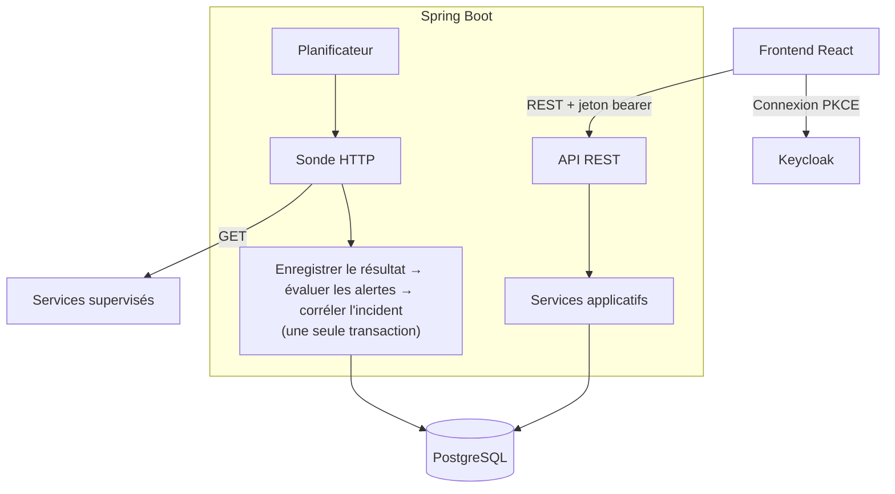

# OpsPilot

[English](README.md) | [Français](README.fr.md)

OpsPilot est une application multi-tenant de supervision et de gestion d'incidents que je développe avec Spring Boot et React.

- Vous enregistrez vos services HTTP.
- OpsPilot les vérifie à intervalle régulier.
- Si un service échoue plusieurs fois de suite, une alerte est créée.
- Les alertes sont regroupées en incidents, que l'équipe prend en charge, assigne, commente et résout.


## Captures d'écran

Bientôt disponible. J'ajouterai des captures du tableau de bord, de la page des alertes et de la chronologie d'un incident, uniquement avec des données de démonstration.

## Démarrage rapide

Prérequis : JDK 21, Docker avec Compose v2, et Node.js 20.19+ ou 22.12+. Ports utilisés : 5173 (frontend), 8080 (API), 8082 (Keycloak) et 5432 (PostgreSQL).

**1. Lancer PostgreSQL et Keycloak**

```sh
git clone https://github.com/Mohamad04/OpsPilot.git
cd OpsPilot
cp infrastructure/.env.example infrastructure/.env   # puis renseigner les valeurs
cd infrastructure
docker compose up -d postgres keycloak
cd ..
```

Au premier démarrage, Keycloak importe le realm `opspilot` depuis [infrastructure/keycloak/opspilot-realm.json](infrastructure/keycloak/opspilot-realm.json). Aucune configuration manuelle de Keycloak n'est nécessaire.

**2. Lancer le backend**

```sh
export DB_URL=jdbc:postgresql://localhost:5432/opspilot   # votre POSTGRES_DB
export DB_USERNAME=...                                     # votre POSTGRES_USER
export DB_PASSWORD=...                                     # votre POSTGRES_PASSWORD
cd backend
./mvnw spring-boot:run
```

Sous Windows, définissez les variables avec `$env:DB_URL = "..."` et lancez `.\mvnw.cmd spring-boot:run`.

**3. Lancer le frontend** (dans un second terminal, depuis la racine du dépôt)

```sh
cd frontend
cp .env.example .env
npm ci
npm run dev
```

**4. Essayer**

1. Ouvrez http://localhost:5173 et connectez-vous avec `demo` / `demo`.
2. Créez une organisation.
3. Ajoutez un service avec une URL HTTP(S) publique.
4. Attendez que les vérifications s'exécutent et observez l'état de santé se mettre à jour.

## Fonctionnalités

| Domaine | Ce que fait l'application |
| --- | --- |
| Connexion et organisations | Connexion Keycloak avec PKCE. Chaque utilisateur appartient à des organisations avec un rôle : `OWNER`, `ADMIN`, `ENGINEER` ou `VIEWER`. |
| Registre des services | Enregistrer, rechercher et filtrer les services. La supervision peut être activée ou désactivée par service. |
| Vérifications HTTP | Un planificateur interroge chaque service actif et enregistre le code HTTP, le temps de réponse et le résultat. |
| Alertes | Par défaut, 3 échecs consécutifs ouvrent une alerte et 2 succès consécutifs la résolvent. Les deux seuils sont configurables de 1 à 20. |
| Incidents | Une alerte active ouvre un incident, ou rejoint l'incident déjà ouvert pour ce service. |
| Cycle de vie d'un incident | `OPEN → ACKNOWLEDGED → INVESTIGATING → MITIGATED → RESOLVED → CLOSED`, avec assignation, commentaires et chronologie complète. |
| Membres | Annuaire des membres, et une API pour ajouter des membres, changer leur rôle ou les retirer. Chaque modification est tracée. |

## Fonctionnement

### Architecture



- **Type :** un monolithe modulaire. L'enregistrement d'un résultat, la mise à jour de l'alerte et celle de l'incident se font dans une seule transaction. Avec des microservices, ce même flux demanderait une coordination entre services.
- **Packages :** `web` (contrôleurs, DTO), `application` (cas d'usage, autorisations, transactions), `domain` (entités, règles métier) et `config`.

### Principaux choix techniques

| Exemple | Pourquoi | Comment |
| --- | --- | --- |
| Un utilisateur de l'organisation A demande un incident de l'organisation B et reçoit `404`. | Une organisation ne doit jamais voir les données d'une autre. | Chaque requête est filtrée par organisation. Des clés étrangères composites empêchent aussi la base de lier des données entre organisations. |
| Deux vérifications du même service se terminent en même temps, mais une seule alerte est ouverte. | Sinon, des workers en parallèle pourraient créer des alertes ou des incidents en double. | La ligne du service est verrouillée pendant l'évaluation. Des index uniques partiels n'autorisent qu'une alerte active et un incident ouvert par service. |
| Deux ingénieurs modifient le même incident. Le second reçoit `409 Conflict`. | Sans cela, la seconde modification écraserait la première sans prévenir. | Chaque modification doit envoyer le `expectedVersion` lu par le client (JPA `@Version`). |
| Le même résultat de vérification est traité deux fois, et rien ne change. | Les nouvelles tentatives et les résultats en retard ne doivent pas faire reculer une alerte. | L'évaluation garde la trace des résultats déjà traités. Les commentaires acceptent aussi une `Idempotency-Key` optionnelle. |
| Quelqu'un tente de modifier un événement d'incident en base, et PostgreSQL refuse. | L'historique des incidents doit rester fiable. | Des triggers bloquent `UPDATE`, `DELETE` et `TRUNCATE` sur les événements d'incident. |
| Un service est enregistré avec `http://localhost` et il est refusé. | La sonde ne doit pas permettre d'atteindre un réseau interne (SSRF). | Toutes les réponses DNS sont validées, les adresses privées sont bloquées et les redirections ne sont pas suivies. |

Les appels réseau s'exécutent en dehors de la transaction. Un service lent ne garde donc jamais une transaction ouverte.

## API

Tous les endpoints exigent un jeton bearer. Dans le tableau ci-dessous, `{org}` correspond à `/api/organisations/{organisationId}`.

| Méthode | Chemin | Rôle |
| --- | --- | --- |
| POST | `/api/me/provision` | Créer l'utilisateur local à partir du jeton |
| GET, POST | `/api/organisations` | Lister ou créer des organisations |
| GET, POST | `{org}/members` | Lister ou ajouter des membres |
| PATCH, DELETE | `{org}/members/{id}` | Changer le rôle d'un membre ou le retirer |
| GET, POST | `{org}/monitored-services` | Lister ou enregistrer des services |
| PATCH | `{org}/monitored-services/{id}/enable`, `/disable` | Activer ou désactiver la supervision |
| GET | `{org}/monitored-services/{id}/health/latest`, `/health/history` | Résultats des vérifications |
| GET, PUT | `{org}/monitored-services/{id}/alert-rule` | Seuils d'alerte |
| GET | `{org}/alerts`, `{org}/alerts/{id}`, `{org}/alerts/summary` | Alertes |
| GET | `{org}/incidents`, `{org}/incidents/{id}`, `{org}/incidents/{id}/events` | Incidents et leur chronologie |
| PATCH | `{org}/incidents/{id}/status` | Changer le statut |
| PATCH | `{org}/incidents/{id}/assignee` | Assigner ou désassigner |
| POST | `{org}/incidents/{id}/comments` | Ajouter un commentaire |

Exemple de changement de statut :

```json
{ "status": "ACKNOWLEDGED", "expectedVersion": 3 }
```

| Rôle | Droits |
| --- | --- |
| `VIEWER` | Lecture seule |
| `ENGINEER` | Modifier les incidents, s'assigner un incident |
| `ADMIN` | Tout ce qui précède, plus la gestion des membres `ENGINEER` et `VIEWER` |
| `OWNER` | Tout, y compris la gestion des membres `ADMIN` |

Les contrats d'API détaillés se trouvent dans [docs/](docs/) (en anglais).

## Stack technique

| Couche | Technologies |
| --- | --- |
| Frontend | React 19, TypeScript, Vite, React Router, TanStack Query, React Hook Form, Zod |
| Backend | Java 21, Spring Boot 4.1, Spring Security (OAuth2 resource server), Spring Data JPA |
| Base de données | PostgreSQL 18, Flyway |
| Authentification | Keycloak 26 |
| Tests | JUnit, Mockito, MockMvc, Testcontainers, Vitest, React Testing Library, Playwright |
| Outillage | Docker Compose, Maven wrapper, Jenkins |

## Tests

```sh
# Backend (Docker est nécessaire pour Testcontainers)
cd backend
./mvnw test

# Frontend
cd frontend
npm run test:run
npm run lint
npm run build
```

- **Backend :** les tests d'intégration tournent sur une vraie base PostgreSQL via Testcontainers. Ils couvrent l'accès entre organisations, l'évaluation concurrente des alertes, les résultats en double et la chronologie immuable.
- **End-to-end :** une suite Playwright (`npm run e2e`) tourne sur l'application réelle, sans mocks. Les pages publiques et la redirection de connexion passent. Les scénarios connectés nécessitent encore des comptes et des données de test dédiés, voir [docs/e2e-environment-fixture-setup.md](docs/e2e-environment-fixture-setup.md).
- **CI :** Jenkins lance les tests backend ([Jenkinsfile](Jenkinsfile)). Il n'y a pas encore d'étape frontend ni de déploiement.

## Configuration

| Variable | Valeur par défaut | Rôle |
| --- | --- | --- |
| `DB_URL`, `DB_USERNAME`, `DB_PASSWORD` | aucune | Connexion PostgreSQL |
| `FRONTEND_URL` | `http://localhost:5173` | Origine CORS autorisée |
| `KEYCLOAK_ISSUER_URI` | `http://localhost:8082/realms/opspilot` | Émetteur des jetons |
| `KEYCLOAK_API_AUDIENCE` | `opspilot-backend` | Audience exigée dans les jetons |
| `MONITORING_INTERVAL_MS` | `60000` | Délai entre deux cycles de vérification |
| `MONITORING_WORKERS` | `4` | Nombre de vérifications en parallèle |
| `MONITORING_ALLOWED_PORTS` | `80,443` | Ports que la sonde peut appeler |

Les autres paramètres sont dans [application.properties](backend/src/main/resources/application.properties).

Remarques :

- L'utilisateur `demo` / `demo` n'existe que dans le fichier de realm local. Il est réservé au développement local.
- Si votre volume Keycloak contient déjà un realm `opspilot`, l'import l'ignore et le laisse tel quel.
- Sur certaines machines Windows, `mvnw.cmd` échoue avec une erreur PowerShell avant le démarrage de Maven. Utiliser directement une installation locale de Maven 3.9 permet de contourner le problème.

## Feuille de route

| Statut | Élément |
| --- | --- |
| Terminé | Authentification, organisations, registre des services |
| Terminé | Supervision HTTP et alertes |
| Terminé | Corrélation, cycle de vie, assignation et commentaires des incidents |
| Terminé | API des membres et interface des incidents |
| En cours | Scénarios Playwright connectés et captures d'écran |
| Bientôt | Interface de gestion des membres et invitations |
| Bientôt | Mises à jour en temps réel (SSE) |
| Bientôt | Notifications (e-mail, Slack) |
| Bientôt | Aide à l'investigation par IA, basée sur les runbooks et les données d'incident, avec validation humaine de chaque action |

C'est un projet portfolio. Il n'est pas déployé en production.

## Organisation du dépôt

| Dossier | Contenu |
| --- | --- |
| `backend/` | API Spring Boot (`web`, `application`, `domain`, `config`) |
| `frontend/` | Application React, avec les tests Playwright dans `e2e/` |
| `infrastructure/` | Docker Compose et le fichier de realm Keycloak |
| `tools/` | Outils de démonstration pour tester les alertes de bout en bout |
| `docs/` | Notes de conception et détails d'API pour chaque fonctionnalité (en anglais) |

## Pour aller plus loin

Documentation détaillée (en anglais) :

- [Supervision et protection SSRF](docs/scheduled-http-health-checks-phase-3a.md)
- [Évaluation des alertes](docs/alert-evaluation-phase-3c-step-2.md)
- [Corrélation des incidents](docs/automatic-incident-correlation-phase-4b.md)
- [API du cycle de vie des incidents](docs/incident-lifecycle-api-phase-4c.md)
- [Assignation et commentaires](docs/incident-assignment-comments-phase-4d.md)
- [API des membres](docs/organisation-membership-api-phase-4d5.md)
- [Isolation des organisations](docs/tenant-isolation-verification.md)
- [Configuration de Keycloak](docs/keycloak-authentication.md)
