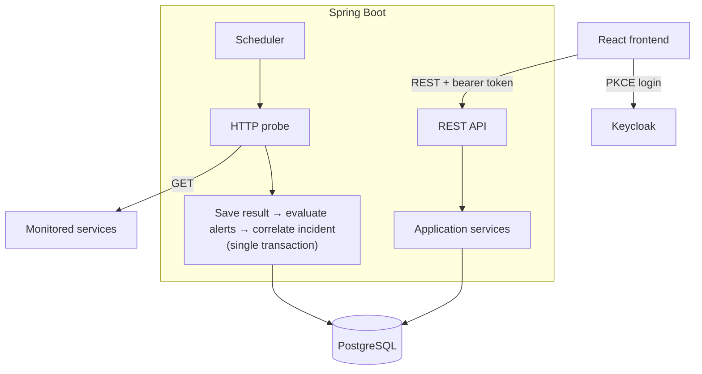

# OpsPilot

OpsPilot is a multi-tenant monitoring and incident management app I'm building with Spring Boot and React. You register HTTP services, it checks them on a schedule, raises alerts when they keep failing, and groups those alerts into incidents your team can work through (acknowledge, assign, comment, resolve).

Most of the effort went into the parts that are easy to get wrong: keeping tenants isolated, handling concurrent writes and retries without duplicating data, and keeping an incident history that can't be edited after the fact.


## What it does

- **Login and organisations**: Keycloak login (Authorization Code + PKCE). Users belong to organisations with one of four roles: `OWNER`, `ADMIN`, `ENGINEER` or `VIEWER`. Permissions are checked on the backend, never trusted from the client.
- **Service registry**: add services, search and filter them, and turn monitoring on or off per service.
- **HTTP health checks**: a scheduler probes enabled services and stores the status code, response time and result. Outbound requests are restricted so the checker can't be pointed at private or internal addresses.
- **Alerting**: per-service rules. By default, 3 failed checks in a row open an alert and 2 successful ones resolve it. Both thresholds can be set anywhere from 1 to 20.
- **Incidents**: an active alert opens an incident, or joins the one already open for that service. Incidents move through `OPEN → ACKNOWLEDGED → INVESTIGATING → MITIGATED → RESOLVED → CLOSED`, can be assigned and commented on, and every change is written to an append-only timeline.
- **Members**: a paginated member directory plus an API for adding members, changing roles and removing members. Membership changes are audited.

There's no AI in the system yet. Down the line I'd like to add runbook-based investigation help (RAG over incident evidence), with any suggested fix still needing a human to approve it.

## Stack

| | |
| --- | --- |
| Frontend | React 19, TypeScript, Vite, React Router, TanStack Query, React Hook Form, Zod |
| Backend | Java 21, Spring Boot 4.1, Spring Security (OAuth2 resource server), Spring Data JPA |
| Database | PostgreSQL 18 with Flyway migrations |
| Auth | Keycloak 26 |
| Testing | JUnit, Mockito, MockMvc, Testcontainers, Vitest, React Testing Library, Playwright |
| Tooling | Docker Compose, Maven wrapper, Jenkins |

## Architecture

It's a modular monolith. Splitting it into microservices would mean coordinating across services for something that fits in one database transaction today.



The code is split into `web` (controllers and DTOs), `application` (use cases, authorization, transactions), `domain` (entities and invariants) and `config`.

Some decisions worth calling out:

- **Tenant isolation**: every query is scoped by organisation, and composite foreign keys stop the database from linking data across organisations even if the code had a bug.
- **Concurrency**: service rows are locked during alert evaluation, and partial unique indexes guarantee there is only one active alert and one open incident per service.
- **Stale updates**: incident updates require the client to send the version it last saw. If someone else changed the incident in the meantime, the API returns `409`.
- **Retries**: alert evaluation tracks which health checks it has already processed, so a duplicated or late check result is ignored. Comments accept an optional `Idempotency-Key`.
- **Audit trail**: database triggers reject `UPDATE` and `DELETE` on incident events, so history can only be appended.
- **Probing happens outside the transaction**: network calls never hold a database transaction open.

## Running it locally

You'll need JDK 21, Docker with Compose v2, and Node.js 20.19+ or 22.12+. The app uses ports 5173 (frontend), 8080 (API), 8082 (Keycloak) and 5432 (Postgres).

### 1. Start Postgres and Keycloak

```sh
git clone https://github.com/Mohamad04/OpsPilot.git
cd OpsPilot
cp infrastructure/.env.example infrastructure/.env
```

Fill in `infrastructure/.env`. The template only has the Postgres variables, so you'll need to add the two Keycloak ones yourself:

```dotenv
POSTGRES_DB=opspilot
POSTGRES_USER=...
POSTGRES_PASSWORD=...
KEYCLOAK_ADMIN=...
KEYCLOAK_ADMIN_PASSWORD=...
```

```sh
cd infrastructure
docker compose up -d postgres keycloak
```

### 2. Set up Keycloak

There's no realm export yet, so this part is manual. Open http://localhost:8082/admin/ and:

1. Create a realm called `opspilot`.
2. Create a public OIDC client `opspilot-frontend` with Standard Flow on, PKCE `S256`, redirect URI `http://localhost:5173/*` and web origin `http://localhost:5173`.
3. In the client's dedicated scope, add an **Audience** mapper for `opspilot-backend` (included in access tokens). The API rejects tokens that don't have this audience.
4. Create a user with a verified email.

More detail in [docs/keycloak-authentication.md](docs/keycloak-authentication.md).

### 3. Run the backend

The backend doesn't read `infrastructure/.env` on its own, so set the connection details in your shell:

```sh
export DB_URL=jdbc:postgresql://localhost:5432/opspilot
export DB_USERNAME=...
export DB_PASSWORD=...
cd backend
./mvnw spring-boot:run
```

On Windows, set the same variables with `$env:DB_URL = "..."` and run `.\mvnw.cmd spring-boot:run`. Flyway runs the migrations on startup.

Keycloak issuer, audience and frontend URL default to the local values above. Monitoring can be tuned with `MONITORING_INTERVAL_MS`, `MONITORING_WORKERS`, `MONITORING_ALLOWED_PORTS` and a few others; see [application.properties](backend/src/main/resources/application.properties).

> On some Windows setups `mvnw.cmd` fails before Maven starts with a PowerShell error. Calling a local Maven 3.9 install directly works around it.

### 4. Run the frontend

```sh
cd frontend
cp .env.example .env
npm ci
npm run dev
```

Go to http://localhost:5173, sign in, create an organisation and add a service. The target has to be a public HTTP(S) URL, because localhost and private IPs are blocked on purpose.

## API

All endpoints need a bearer token. `{org}` below is `/api/organisations/{organisationId}`.

| Method | Path | |
| --- | --- | --- |
| POST | `/api/me/provision` | Create the local user from the token |
| GET, POST | `/api/organisations` | List or create organisations |
| GET, POST | `{org}/members` | List or add members |
| PATCH, DELETE | `{org}/members/{id}` | Change a member's role or remove them |
| GET, POST | `{org}/monitored-services` | List or register services |
| PATCH | `{org}/monitored-services/{id}/enable` and `/disable` | Turn monitoring on or off |
| GET | `{org}/monitored-services/{id}/health/latest` and `/health/history` | Health check results |
| GET, PUT | `{org}/monitored-services/{id}/alert-rule` | Alert thresholds |
| GET | `{org}/alerts`, `{org}/alerts/{id}`, `{org}/alerts/summary` | Alerts |
| GET | `{org}/incidents`, `{org}/incidents/{id}`, `{org}/incidents/{id}/events` | Incidents and their timeline |
| PATCH | `{org}/incidents/{id}/status` | Change status (needs `expectedVersion`) |
| PATCH | `{org}/incidents/{id}/assignee` | Assign or unassign |
| POST | `{org}/incidents/{id}/comments` | Add a comment |

Example status change:

```json
{ "status": "ACKNOWLEDGED", "expectedVersion": 3 }
```

Viewers can read but not write. Engineers can update incidents and assign them to themselves. Owners and admins can do everything, including managing members. The full contracts are in [docs/](docs/).

## Tests

```sh
# backend (needs Docker for Testcontainers)
cd backend && ./mvnw test

# frontend
cd frontend
npm run test:run
npm run lint
npm run build
```

Backend integration tests run against a real Postgres in Testcontainers and cover things like cross-tenant access, concurrent alert evaluation, duplicate check results and the immutable timeline.

There's also a Playwright suite (`npm run e2e`) that runs against the real app, with no mocks. The public pages and the login redirect pass. The logged-in scenarios need dedicated test accounts and data, which I haven't set up yet. See [docs/e2e-environment-fixture-setup.md](docs/e2e-environment-fixture-setup.md).

Jenkins runs the backend tests (see the [Jenkinsfile](Jenkinsfile)). There's no frontend or deploy stage yet.

## Status

Done so far: auth, organisations, service registry, HTTP monitoring, alerting, incident correlation and lifecycle, assignment and comments, the membership API, and the incidents UI.

Still to do:

- Run the logged-in Playwright scenarios and take screenshots
- A UI for managing members, and invitations
- Real-time updates (SSE)
- Notifications (email, Slack, etc.)
- AI-assisted investigation

This is a portfolio project, not something running in production.

## Project layout

```text
backend/         Spring Boot API (web / application / domain / config)
frontend/        React app, plus Playwright tests in e2e/
infrastructure/  Docker Compose for Postgres and Keycloak
tools/           Small demo tooling for testing alerts end to end
docs/            Design notes and API details for each feature
```

The `docs/` folder has the longer write-ups: [monitoring and SSRF protection](docs/scheduled-http-health-checks-phase-3a.md), [alert evaluation](docs/alert-evaluation-phase-3c-step-2.md), [incident correlation](docs/automatic-incident-correlation-phase-4b.md), [incident lifecycle API](docs/incident-lifecycle-api-phase-4c.md), [assignment and comments](docs/incident-assignment-comments-phase-4d.md), [membership API](docs/organisation-membership-api-phase-4d5.md) and [tenant isolation](docs/tenant-isolation-verification.md).
