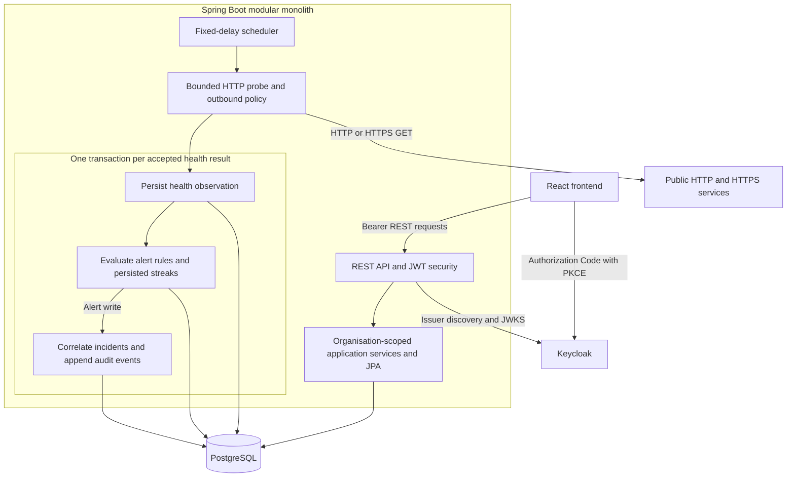

# OpsPilot

**Multi-tenant HTTP monitoring, alerting and incident management, with AI-assisted investigation planned.**


OpsPilot helps engineering and operations teams track service availability, turn repeated failures into actionable alerts, and preserve the evidence behind operational incidents. It brings service registration, scheduled HTTP checks, configurable failure/recovery thresholds and incident lifecycle management into one organisation-scoped system.

The project focuses on the correctness problems behind that workflow: tenant isolation, concurrent processing, retry safety, transactional updates and an immutable audit trail. It is an actively developed modular monolith, with a React monitoring/alerting interface and a Spring Boot incident-management API. Incident UI and AI assistance are future work; no AI model currently participates in monitoring or operational decisions.

[Features](#implemented-features) · [Architecture](#architecture) · [Run locally](#getting-started) · [API](#api-overview) · [Documentation](#documentation)

## Implemented features

| Domain | Available today |
| --- | --- |
| Identity and onboarding | Keycloak hosted login/logout, Authorization Code flow with PKCE S256, in-memory tokens and refresh; local user provisioning from validated JWT identity; organisation creation and selection. |
| Access control | Backend-enforced organisation membership and `OWNER`, `ADMIN`, `ENGINEER`, `VIEWER` permissions. Provisioning creates no membership; an organisation's creator becomes its OWNER. |
| Service registry | Organisation-scoped registration, search/filtering in the UI, service details and enable/disable controls. Registration supports multiple service types; automated probing currently supports **HTTP only**. |
| HTTP monitoring | Scheduled checks, bounded timeouts/workers, persisted status, HTTP code, response time and timestamps; latest-result and bounded-history APIs and UI. |
| Alerting | Per-HTTP-service rules, persistent failure/recovery streaks, `ACTIVE → RESOLVED` lifecycle, evidence references, paginated/filterable alert APIs, summaries, React alert list/details and rule configuration. |
| Incident correlation | An ACTIVE alert opens an OPEN incident or joins an ongoing incident for the same organisation/service. Retries do not duplicate associations/events; severity can escalate without downgrading. |
| Incident lifecycle | Backend list/detail/timeline APIs and validated status changes across OPEN, ACKNOWLEDGED, INVESTIGATING, MITIGATED, RESOLVED and CLOSED, including guarded reopening. |
| Audit and reliability | Immutable incident events, attributed human transitions, system-generated alert events, schema constraints, concurrency controls and PostgreSQL integration tests. |

### Three distinct kinds of state

| State | Meaning |
| --- | --- |
| Service `enabled` / `disabled` | Whether monitoring is configured to run. Enabled does **not** mean healthy. |
| Health `UP` / `DOWN` / `UNKNOWN` | The last recorded HTTP observation. UP requires a final 2xx response; network failures/non-2xx responses are DOWN. Policy/internal failures can be UNKNOWN. |
| Alert `ACTIVE` / `RESOLVED` | A threshold-based failure/recovery lifecycle. An alert can remain ACTIVE during early recovery checks. |

Default alert rules require **3 consecutive DOWN checks** to open an alert and **2 consecutive UP checks** to resolve it, with severity HIGH. Thresholds are configurable from 1–20. UNKNOWN resets both streaks and neither opens nor resolves an alert. A later outage creates a new alert; resolved history remains available.

Alert recovery records incident evidence but does **not** automatically resolve the incident. Manual incident resolution/closure is rejected while linked alerts remain ACTIVE.

## Product walkthrough and demonstration

The React application provides the following views using authenticated backend data:

| View | What it demonstrates |
| --- | --- |
| Dashboard (`/`) | Selected-organisation service counts, monitoring observations and alert summaries. |
| Services (`/services`) | Searchable registry, configuration state and observed health, with a compact mobile layout. |
| Service details (`/services/:id`) | HTTP results/history, response times, alert configuration and associated alerts. |
| Alerts (`/alerts`, `/alerts/:alertId`) | Server-paginated filters, severity/lifecycle labels and health-check evidence. |

No application screenshots are currently committed. This showcase intentionally contains no placeholder images or unavailable image links. Future captures should show these views with disposable data and no personal information. **Incident list, detail and timeline screenshots will be added when the incident frontend exists.**

The [alerting E2E validation report](docs/alerting-e2e-validation.md) records a **user-confirmed manual** live sequence: HTTP 200 → UP → HTTP 503 → DOWN → ACTIVE after three failures → UP → RESOLVED after two recoveries. This is separate from automated test results; independently captured browser/API evidence is not claimed.

The reproducible [Node.js demo tooling](tools/alert-e2e-demo/README.md) uses built-in modules and a temporary public HTTPS tunnel. Historical tunnel URLs are not permanent demo deployments. Disable the dedicated TEST service before stopping its tunnel, preserving health and alert history.

## Technology stack

Versions below follow the committed manifests, lockfile and container image declarations; the backend API and frontend remain separate development processes.

| Area | Technology | Role |
| --- | --- | --- |
| Frontend | React 19, TypeScript 6, Vite 8, React Router 8 | Responsive dashboard and navigation. |
| Server state and forms | TanStack Query 5, React Hook Form 7, Zod 4 | Organisation-scoped caching, mutations, form and response validation. |
| Backend | Java 21, Spring Boot 4.1.0, Spring MVC, Spring Data JPA/Hibernate | REST endpoints, application services and encapsulated domain models. |
| Persistence | PostgreSQL 18.4, Flyway | Relational integrity, migrations and persisted monitoring/evaluation state. |
| Authentication | Keycloak 26.7.1 server, keycloak-js 26, Spring Security OAuth2 resource server | PKCE login; JWT signature, issuer, expiry and API-audience validation. |
| Backend testing | JUnit Jupiter 6, Mockito, MockMvc, Testcontainers | Domain/unit tests and real PostgreSQL/security integration tests. |
| Frontend testing | Vitest 4, React Testing Library, jsdom, ESLint 10 | Component/API interaction tests, linting and TypeScript production builds. |
| Local infrastructure and CI | Docker Compose, Maven wrapper (3.9.16), Jenkins | Persistent local infrastructure and a Windows/Docker backend test pipeline. |

AI providers, vector storage, RAG infrastructure, brokers and distributed workers are **not integrated**. No particular AI infrastructure is required to run OpsPilot today.

## Architecture



The backend uses `web`, `application`, `domain` and `config` packages. Controllers translate requests into application operations; services own authorization and transaction boundaries; domain methods enforce invariants; repositories and PostgreSQL enforce persistence rules.

A modular monolith keeps health observations, alert transitions, incident correlation and timeline writes in a single database transaction. Network probes run **outside** that transaction. This gives the current system a straightforward consistency model and deployment footprint while domain boundaries remain explicit. Microservices would introduce distributed coordination before the project needs independent deployment or scaling.

### Engineering highlights

| Challenge | Implementation and trade-off |
| --- | --- |
| Tenant isolation | Membership checks and organisation-scoped queries protect application access. Composite foreign keys independently prevent cross-organisation service/result/alert/incident associations. See the [isolation verification](docs/tenant-isolation-verification.md). |
| Safe outbound checks | [HealthTargetPolicy](backend/src/main/java/com/opspilot/backend/application/HealthTargetPolicy.java) rejects private/special destinations and validates all DNS answers. [HttpHealthProbe](backend/src/main/java/com/opspilot/backend/application/HttpHealthProbe.java) connects to a validated IP, retains TLS hostname verification and does not follow redirects or forward user credentials. Deployment egress controls remain necessary. |
| Retry and ordering safety | [AlertEvaluationEngine](backend/src/main/java/com/opspilot/backend/application/AlertEvaluationEngine.java) uses persisted counters and processed-observation state; duplicate/older observations cannot regress the lifecycle. Rule/configuration changes reset streaks without deleting history. |
| Concurrent writes | Pessimistic service-row locking serializes cooperating evaluation/correlation writers. Partial unique indexes enforce one ACTIVE alert per service/category and one ongoing incident per service. This is not a distributed scheduler guarantee. |
| Explainable correlation | [IncidentCorrelationService](backend/src/main/java/com/opspilot/backend/application/IncidentCorrelationService.java) groups by exact organisation/service and ongoing status, reuses prior alert associations and never silently reopens finished incidents. There is no heuristic or AI grouping. |
| Lost-update prevention | [IncidentService](backend/src/main/java/com/opspilot/backend/application/IncidentService.java) combines a consistent service-then-incident lock order with JPA `@Version` and a required `expectedVersion`. Stale transitions and conflicting reopen requests return 409. |
| Durable audit history | Incident changes and timeline entries commit together. JPA immutability and PostgreSQL UPDATE/DELETE/TRUNCATE rejection triggers protect events. System actors are distinct from authenticated human actors; database-owner privileges still require operational control. |
| Schema evolution | [Flyway migrations](backend/src/main/resources/db/migration/) V1–V11 encode UUID keys, checks, tenant-safe relationships and lifecycle constraints. Hibernate validates the schema rather than generating production tables. |

## Getting started

### Prerequisites

- JDK **21** and a Docker engine capable of running Linux containers, with Docker Compose v2.
- Node.js **24** is the documented local baseline. The locked Vite version requires Node `^20.19.0 || >=22.12.0`; npm is used with `package-lock.json`.
- Git. Maven is normally supplied by the wrapper; dependencies and container images need network access on the first run.
- Available local ports: **5173** (frontend), **8080** (backend), **8082** (Keycloak), **5432** (PostgreSQL).

Jenkins is optional and is not started by the Compose file. The Compose configuration uses Keycloak `start-dev` and local persistent volumes; it is a development setup, not a hardened production deployment.

### 1. Clone and configure infrastructure

```sh
git clone https://github.com/Mohamad04/OpsPilot.git
cd OpsPilot
```

Copy the existing template, preserving any existing local configuration:

```powershell
# PowerShell, from the repository root; skip this copy if .env already exists.
Copy-Item infrastructure/.env.example infrastructure/.env
```

On Unix-like systems use `cp infrastructure/.env.example infrastructure/.env` instead.

Edit `infrastructure/.env` locally and supply the following values. The current template lists only the PostgreSQL variables; **add both Keycloak variables** required by Compose.

| Variable | Purpose |
| --- | --- |
| `POSTGRES_DB` | Local application database name. |
| `POSTGRES_USER` | Local PostgreSQL application username. |
| `POSTGRES_PASSWORD` | Locally chosen database credential. |
| `KEYCLOAK_ADMIN` | Locally chosen Keycloak bootstrap administrator username. |
| `KEYCLOAK_ADMIN_PASSWORD` | Locally chosen Keycloak bootstrap administrator credential. |

Use simple, unquoted `KEY=VALUE` entries for the loading examples below. Keep this file private; it is ignored by Git. No credentials belong in the README or `VITE_*` variables. Bootstrap settings initialise a fresh Keycloak installation; changing them does not reset an existing administrator.

```sh
cd infrastructure
docker compose up -d postgres keycloak
cd ..
```

Volumes preserve infrastructure data. Do not remove volumes or reset an existing database to resolve setup errors.

### 2. Configure Keycloak

Open [the local Admin Console](http://localhost:8082/admin/) with your locally configured credentials. No realm import is currently supplied, so a fresh installation needs manual setup:

1. Create realm **opspilot** and public OpenID Connect client **opspilot-frontend**. Client authentication is **Off**; Standard Flow is **On**; Implicit Flow and Direct Access Grants are **Off**. Require PKCE **S256**.
2. Allow redirect URI `http://localhost:5173/*`, web origin `http://localhost:5173` and post-logout redirect URI `http://localhost:5173/`.
3. Add an **Audience** mapper to the frontend client's dedicated scope: Included Custom Audience `opspilot-backend`, included in access tokens. The API validates this audience; the frontend client ID alone is insufficient.
4. Create a test user using the console's credential workflow, with a valid email marked **verified**. New local accounts require a verified email. Existing-email conflicts do not automatically link identities.

See [authentication setup](docs/keycloak-authentication.md) and [user provisioning](docs/user-provisioning.md) for the complete policy. JWT identity comes from the validated `sub`; Keycloak realm roles do not grant organisation permissions.

### 3. Start the backend

Spring Boot requires these environment variables in its own process; it does not automatically load `infrastructure/.env`:

| Variable | Value or default |
| --- | --- |
| `DB_URL` | `jdbc:postgresql://localhost:5432/` followed by your `POSTGRES_DB`. |
| `DB_USERNAME`, `DB_PASSWORD` | Same credentials configured for PostgreSQL. |
| `FRONTEND_URL` | Defaults to `http://localhost:5173`. |
| `KEYCLOAK_ISSUER_URI` | Defaults to `http://localhost:8082/realms/opspilot`. |
| `KEYCLOAK_API_AUDIENCE` | Defaults to `opspilot-backend`. |

For the simple environment file above, PowerShell can load the database settings without printing credentials:

```powershell
# From the repository root, in the backend terminal.
Get-Content infrastructure/.env | ForEach-Object {
    if ($_ -match '^(POSTGRES_DB|POSTGRES_USER|POSTGRES_PASSWORD)=(.*)$') {
        Set-Item -Path "Env:$($Matches[1])" -Value $Matches[2]
    }
}
$env:DB_URL = 'jdbc:postgresql://localhost:5432/' + $env:POSTGRES_DB
$env:DB_USERNAME = $env:POSTGRES_USER
$env:DB_PASSWORD = $env:POSTGRES_PASSWORD
Set-Location backend
.\mvnw.cmd spring-boot:run
```

On Unix-like systems, export the same `DB_*` variables in your shell or configure them in your IDE, then run `./mvnw spring-boot:run` from `backend` (`sh mvnw spring-boot:run` if the executable bit is unavailable).

**Known Windows wrapper limitation:** previous local runs failed before Maven started with a PowerShell null-array error. The verified local workaround used the already-cached **Maven 3.9.16** executable with explicit cache/home paths and offline mode; see the [Phase 4C validation commands](docs/incident-lifecycle-api-phase-4c.md#validation-results). If you have that Maven distribution available, invoke its `bin/mvn.cmd` directly with `spring-boot:run`, `test` or `package`. Offline mode (`-o`) works only when the required artifacts are already cached; it is not a fresh-install solution. The wrapper has not been replaced or repaired.

Normal application startup applies Flyway migrations and validates JPA mappings. Use the development database configured above; do not use Flyway repair/baseline or table resets as a shortcut. Startup also enables scheduled checks for existing enabled HTTP services.

### 4. Start the frontend and sign in

In a separate terminal:

```powershell
Set-Location frontend
# Skip the copy if .env already exists; preserve other settings.
Copy-Item .env.example .env
npm ci
npm run dev
```

On Unix-like systems use `cd frontend` and `cp .env.example .env` for the first two operations. The remaining npm commands are identical. On Windows use `npm.cmd` if the shell blocks the npm PowerShell shim.

The supplied [frontend template](frontend/.env.example) contains only public configuration:

```dotenv
VITE_API_BASE_URL=http://localhost:8080
VITE_KEYCLOAK_URL=http://localhost:8082
VITE_KEYCLOAK_REALM=opspilot
VITE_KEYCLOAK_CLIENT_ID=opspilot-frontend
```

Open **http://localhost:5173**. Keycloak login and local provisioning finish before organisation-dependent content loads. A new user can create an organisation, then register a service. Use a public HTTP/HTTPS target you control: the outbound policy intentionally rejects loopback/private destinations even during local development.

### Monitoring configuration

These optional backend environment variables follow [application.properties](backend/src/main/resources/application.properties):

| Variable | Default | Meaning |
| --- | --- | --- |
| `MONITORING_ENABLED` | `true` | Enable the scheduled monitoring task. |
| `MONITORING_INTERVAL_MS` | `60000` | Delay after a completed checking round, not an exact per-service cadence. |
| `MONITORING_INITIAL_DELAY_MS` | `10000` | Initial scheduler delay. |
| `MONITORING_CONNECT_TIMEOUT_MS` | `2000` | Bounded connection timeout. |
| `MONITORING_REQUEST_TIMEOUT_MS` | `5000` | Total caller/request deadline. |
| `MONITORING_WORKERS` | `4` | Bounded network-worker capacity. |
| `MONITORING_ALLOWED_PORTS` | `80,443` | Allowed destination ports; does not bypass address restrictions. |

See [monitoring configuration and limitations](docs/scheduled-http-health-checks-phase-3a.md) for validation ranges, DNS cancellation limits and SSRF controls.

## API overview

Protected requests require `Authorization: Bearer <access token>` issued by the configured Keycloak realm with the API audience. Organisation IDs in paths identify scope; they never grant access. Local membership and resource scope are verified on the backend.

Let `{base}` mean `/api/organisations/{organisationId}`:

| Method | Path | Purpose |
| --- | --- | --- |
| POST | `/api/me/provision` | Idempotent local account provisioning from JWT claims. |
| GET / POST | `/api/organisations` | List the user's organisations / create one with OWNER membership. |
| GET / POST | `{base}/monitored-services` | List / register services. |
| PATCH | `{base}/monitored-services/{serviceId}/enable` or `/disable` | Change monitoring configuration. |
| GET | `{base}/monitored-services/{serviceId}/health/latest` or `/health/history` | Latest observation / bounded history (`limit`, default 20, maximum 100). |
| GET / PUT | `{base}/monitored-services/{serviceId}/alert-rule` | Effective defaults / idempotent configuration update. |
| GET | `{base}/alerts`, `/alerts/{alertId}`, `/alerts/summary` | Paginated alerts, details and database-aggregated counts. |
| GET | `{base}/monitored-services/{serviceId}/alerts` | Service-scoped alert history. |
| GET | `{base}/incidents`, `/incidents/{incidentId}`, `/incidents/{incidentId}/events` | Incident list, details and paginated timeline. |
| PATCH | `{base}/incidents/{incidentId}/status` | Validated lifecycle transition with version precondition. |

Alert lists support `status`, `severity`, `serviceId`, `from` and `to`, with zero-based `page=0`, `size=20` and maximum size 100. Dates select `firstSeenAt` using **inclusive from / exclusive to**. Ordering is `firstSeenAt DESC, id DESC`.

Incident lists support `status`, `severity`, `serviceId`, the same pagination bounds and `sort=createdAt,desc` (or `createdAt,asc`), with a deterministic ID tie-breaker. Timeline ordering is chronological. Reads do not change domain state.

For an OPEN incident, first GET its current representation, then PATCH its `/status` endpoint with the returned `version`:

```json
{
  "status": "ACKNOWLEDGED",
  "expectedVersion": 0
}
```

`0` is illustrative: always send the actual version just read. The authenticated member supplies the audit actor; the body cannot grant roles or choose another tenant. Invalid input returns 400, missing/invalid authentication 401, insufficient write permission 403, unavailable scoped resources 404, and invalid/stale/conflicting transitions 409. OWNER, ADMIN and ENGINEER can perform these operational writes; VIEWER can read.

See the detailed [alert API contract](docs/alert-management-api-phase-3c-step-3.md) and [incident API, transition matrix and response schemas](docs/incident-lifecycle-api-phase-4c.md).

## Testing and quality assurance

Backend tests combine JUnit/Mockito unit tests with MockMvc and **disposable PostgreSQL 18.4 Testcontainers**. Coverage includes Flyway/Hibernate compatibility, real signed-JWT validation, membership/RBAC, cross-tenant access, threshold/recovery behavior, concurrent writers, duplicate/late observations, atomic rollback and immutable timeline enforcement. Controlled HTTP test endpoints avoid depending on external websites for deterministic checks.

Frontend tests use Vitest, React Testing Library and jsdom for response validation, forms, filtering/paging, loading/errors, organization switching, delayed responses and cache isolation. jsdom interaction tests do not prove CSS rendering, real browser focus behavior or responsive screenshots.

```powershell
# From backend; Docker must be available for integration tests.
.\mvnw.cmd test
.\mvnw.cmd package

# From frontend, in a separate terminal.
npm run test:run
npm run lint
npm run build

# From the repository root.
git diff --check
```

Use `./mvnw test` / `./mvnw package` on Unix-like systems, or the documented cached-Maven workaround where necessary. Individual phase reports preserve actual execution results and environment limitations; test totals are intentionally not presented as a permanent build-status badge.

The [Jenkins pipeline](Jenkinsfile) runs `mvnw.cmd test` on an agent labelled `windows-docker`, uses the configured `JDK21` tool and publishes Surefire JUnit reports. The checked-in pipeline currently has **no frontend stage or deployment stage**. Its wrapper command may encounter the documented Windows startup issue; a successful current CI run is not asserted here.

## Development status and roadmap

| Milestone | Status | Scope |
| --- | --- | --- |
| Foundations and responsive UI | Implemented | Authentication, provisioning, organisations, registry and responsive application shell. |
| Phase 3A–3B | Implemented | Scheduled HTTP monitoring, persistence, read APIs and frontend integration. |
| Phase 3C | Implemented | Alert rules, evaluation, recovery, management APIs and React alerting UI; manual live lifecycle evidence documented separately. |
| Phase 4A | Implemented | Incident domain, tenant-safe associations and immutable timeline persistence. |
| Phase 4B | Implemented | Automatic creation, deterministic correlation and recovery evidence. |
| Phase 4C | Implemented | Backend lifecycle management, version checks, scoped REST APIs and regression coverage. |
| Phase 4D | Next; not implemented | Assignment management and human comments. |
| Phase 4E onward | Planned | Incident frontend and subsequent operational workflows; scope to be defined in later increments. |
| Longer-term direction | Planned | Evidence-grounded AI assistance, runbooks, observability integrations and deployment/infrastructure expansion. |

“Implemented” describes repository functionality within each milestone's acceptance scope, not production-readiness or a deployed service. Incident management currently has no React pages. There is no notification delivery, SSE, distributed scheduling, automatic retention policy or production deployment pipeline.

### Future AI assistance — not implemented

The intended direction is RAG over operational runbooks and incident evidence, producing cited root-cause hypotheses, structured investigation recommendations and draft postmortems. Observability integrations could enrich that evidence. Provider/model selection, vector infrastructure and evaluation criteria remain future design decisions.

Proposed remediation must remain **human-approved**: an AI-generated recommendation must not independently authorize operational changes. Today's monitoring and correlation are deterministic and do not depend on an AI service.

## Repository structure

```text
OpsPilot/
├── backend/
│   ├── src/main/java/com/opspilot/backend/
│   │   ├── application/     # Use cases, monitoring, evaluation and correlation
│   │   ├── domain/          # Entities, invariants and repository contracts
│   │   ├── web/             # Controllers, DTOs and API errors
│   │   └── config/          # Security, CORS and monitoring configuration
│   ├── src/main/resources/db/migration/
│   └── src/test/            # Unit, PostgreSQL and authentication tests
├── frontend/src/            # React pages, auth, API clients, query hooks and tests
├── infrastructure/          # Local PostgreSQL/Keycloak Compose and env template
├── tools/alert-e2e-demo/     # Disposable HTTP target and reproducible test tooling
├── docs/                    # Architecture decisions, contracts and milestone reports
├── Jenkinsfile              # Backend test pipeline
└── AGENTS.md                # Engineering and documentation-maintenance policy
```

## Documentation

The phase reports contain architectural decisions, implementation details, actual test evidence and known limitations. Earlier reports describe their milestone's scope; later reports extend it.

| Topic | Detailed documentation |
| --- | --- |
| Security and onboarding | [Keycloak](docs/keycloak-authentication.md), [provisioning](docs/user-provisioning.md), [organisation onboarding](docs/organisation-onboarding.md), [tenant isolation](docs/tenant-isolation-verification.md) |
| UI foundations | [Responsive shell](docs/responsive-layout-phase-1.md), [services](docs/responsive-services-phase-2-2.md), [dashboard](docs/dashboard-phase-2-3.md) |
| Monitoring | [Backend design and SSRF policy](docs/scheduled-http-health-checks-phase-3a.md), [React integration](docs/monitoring-dashboard-phase-3b.md), [live-verification record](docs/monitoring-live-verification.md) |
| Alerting | [Rules](docs/alert-rule-configuration-phase-3c-step-1.md), [evaluation/concurrency](docs/alert-evaluation-phase-3c-step-2.md), [REST API](docs/alert-management-api-phase-3c-step-3.md), [React UI](docs/alerting-frontend-phase-3c-step-4.md) |
| Incidents | [Domain and database](docs/incident-domain-phase-4a.md), [automatic correlation](docs/automatic-incident-correlation-phase-4b.md), [lifecycle/API](docs/incident-lifecycle-api-phase-4c.md) |
| Live demonstration | [Manual E2E evidence and cleanup](docs/alerting-e2e-validation.md), [demo instructions](tools/alert-e2e-demo/README.md) |
| Maintenance | [Persistent project guidance](AGENTS.md) |

These boundaries and trade-offs are intentional: OpsPilot demonstrates how monitoring evidence becomes an auditable incident workflow while keeping authorization, data integrity and failure behavior explicit.
