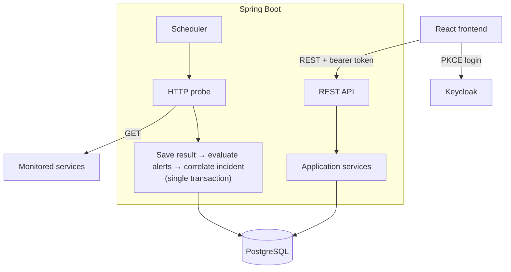

# OpsPilot

[English](README.md) | [Français](README.fr.md)

OpsPilot is a multi-tenant monitoring and incident management application that I am building with Spring Boot and React.

- You register your HTTP services.
- OpsPilot checks them on a schedule.
- If a service keeps failing, it raises an alert.
- Alerts are grouped into incidents that your team acknowledges, assigns, comments on and resolves.


## Screenshots

Coming soon. I will add captures of the dashboard, the alerts page and an incident timeline, using demo data only.

## Quick start

Requirements: JDK 21, Docker with Compose v2, and Node.js 20.19+ or 22.12+. Ports used: 5173 (frontend), 8080 (API), 8082 (Keycloak) and 5432 (PostgreSQL).

**1. Start PostgreSQL and Keycloak**

```sh
git clone https://github.com/Mohamad04/OpsPilot.git
cd OpsPilot
cp infrastructure/.env.example infrastructure/.env   # then fill in the values
cd infrastructure
docker compose up -d postgres keycloak
cd ..
```

On first start, Keycloak imports the `opspilot` realm from [infrastructure/keycloak/opspilot-realm.json](infrastructure/keycloak/opspilot-realm.json). No manual Keycloak setup is needed.

**2. Start the backend**

```sh
export DB_URL=jdbc:postgresql://localhost:5432/opspilot   # use your POSTGRES_DB
export DB_USERNAME=...                                     # your POSTGRES_USER
export DB_PASSWORD=...                                     # your POSTGRES_PASSWORD
cd backend
./mvnw spring-boot:run
```

On Windows, set the variables with `$env:DB_URL = "..."` and run `.\mvnw.cmd spring-boot:run`.

**3. Start the frontend** (in a second terminal, from the repository root)

```sh
cd frontend
cp .env.example .env
npm ci
npm run dev
```

**4. Try it**

1. Open http://localhost:5173 and sign in with `demo` / `demo`.
2. Create an organisation.
3. Add a service with a public HTTP(S) URL.
4. Wait for the checks to run and watch the health status update.

## Features

| Area | What it does |
| --- | --- |
| Login and organisations | Keycloak login with PKCE. Users belong to organisations with a role: `OWNER`, `ADMIN`, `ENGINEER` or `VIEWER`. |
| Service registry | Register, search and filter services. Monitoring can be turned on or off per service. |
| HTTP health checks | A scheduler probes each enabled service and stores the status code, response time and result. |
| Alerting | By default, 3 failed checks in a row open an alert and 2 successful checks resolve it. Both values can be set from 1 to 20. |
| Incidents | An active alert opens an incident, or joins the incident already open for that service. |
| Incident workflow | `OPEN → ACKNOWLEDGED → INVESTIGATING → MITIGATED → RESOLVED → CLOSED`, with assignment, comments and a full timeline. |
| Members | Member directory, plus an API to add members, change roles and remove members. Every change is audited. |

## How it works

### Architecture



- **Type:** a modular monolith. Saving a health check result, updating the alert and updating the incident all happen in one database transaction. With microservices, the same flow would need coordination across services.
- **Packages:** `web` (controllers, DTOs), `application` (use cases, authorisation, transactions), `domain` (entities, rules) and `config`.

### Key design decisions

| Example | Why | How |
| --- | --- | --- |
| A user from organisation A asks for an incident of organisation B and gets `404`. | One organisation must never see another organisation's data. | Every query is scoped by organisation. Composite foreign keys also stop the database from linking data across organisations. |
| Two health checks for the same service finish at the same time, but only one alert is opened. | Parallel workers could otherwise create duplicate alerts or incidents. | The service row is locked during evaluation. Partial unique indexes allow only one active alert and one open incident per service. |
| Two engineers update the same incident. The second one gets `409 Conflict`. | Without this, the second update would silently overwrite the first. | Each update must send the `expectedVersion` the client last read (JPA `@Version`). |
| The same health check result is processed twice, and nothing changes. | Retries and late results must not move an alert backwards. | Alert evaluation records which results it has already processed. Comments also accept an optional `Idempotency-Key`. |
| Someone tries to edit an incident event in the database, and PostgreSQL rejects it. | The incident history must stay trustworthy. | Database triggers block `UPDATE`, `DELETE` and `TRUNCATE` on incident events. |
| A service is registered with `http://localhost` and is rejected. | The checker must not be usable to reach internal networks (SSRF). | All DNS answers are validated, private addresses are blocked, and redirects are not followed. |

Network calls run outside the database transaction, so a slow service never keeps a transaction open.

## API

All endpoints require a bearer token. In the table below, `{org}` means `/api/organisations/{organisationId}`.

| Method | Path | Purpose |
| --- | --- | --- |
| POST | `/api/me/provision` | Create the local user from the token |
| GET, POST | `/api/organisations` | List or create organisations |
| GET, POST | `{org}/members` | List or add members |
| PATCH, DELETE | `{org}/members/{id}` | Change a member's role or remove the member |
| GET, POST | `{org}/monitored-services` | List or register services |
| PATCH | `{org}/monitored-services/{id}/enable`, `/disable` | Turn monitoring on or off |
| GET | `{org}/monitored-services/{id}/health/latest`, `/health/history` | Health check results |
| GET, PUT | `{org}/monitored-services/{id}/alert-rule` | Alert thresholds |
| GET | `{org}/alerts`, `{org}/alerts/{id}`, `{org}/alerts/summary` | Alerts |
| GET | `{org}/incidents`, `{org}/incidents/{id}`, `{org}/incidents/{id}/events` | Incidents and their timeline |
| PATCH | `{org}/incidents/{id}/status` | Change the status |
| PATCH | `{org}/incidents/{id}/assignee` | Assign or unassign |
| POST | `{org}/incidents/{id}/comments` | Add a comment |

Example of a status change:

```json
{ "status": "ACKNOWLEDGED", "expectedVersion": 3 }
```

| Role | Permissions |
| --- | --- |
| `VIEWER` | Read only |
| `ENGINEER` | Update incidents, assign incidents to themselves |
| `ADMIN` | Everything above, plus managing `ENGINEER` and `VIEWER` members |
| `OWNER` | Everything, including managing `ADMIN` members |

The full API contracts are in [docs/](docs/).

## Tech stack

| Layer | Technologies |
| --- | --- |
| Frontend | React 19, TypeScript, Vite, React Router, TanStack Query, React Hook Form, Zod |
| Backend | Java 21, Spring Boot 4.1, Spring Security (OAuth2 resource server), Spring Data JPA |
| Database | PostgreSQL 18, Flyway |
| Authentication | Keycloak 26 |
| Tests | JUnit, Mockito, MockMvc, Testcontainers, Vitest, React Testing Library, Playwright |
| Tooling | Docker Compose, Maven wrapper, Jenkins |

## Tests

```sh
# Backend (Docker is required for Testcontainers)
cd backend
./mvnw test

# Frontend
cd frontend
npm run test:run
npm run lint
npm run build
```

- **Backend:** integration tests run against a real PostgreSQL database in Testcontainers. They cover cross-tenant access, concurrent alert evaluation, duplicate check results and the immutable timeline.
- **End-to-end:** a Playwright suite (`npm run e2e`) runs against the real application, with no mocks. The public pages and the login redirect pass. The logged-in scenarios still need dedicated test accounts and data, see [docs/e2e-environment-fixture-setup.md](docs/e2e-environment-fixture-setup.md).
- **CI:** Jenkins runs the backend tests ([Jenkinsfile](Jenkinsfile)). There is no frontend or deployment stage yet.

## Configuration

| Variable | Default | Purpose |
| --- | --- | --- |
| `DB_URL`, `DB_USERNAME`, `DB_PASSWORD` | none | PostgreSQL connection |
| `FRONTEND_URL` | `http://localhost:5173` | Allowed CORS origin |
| `KEYCLOAK_ISSUER_URI` | `http://localhost:8082/realms/opspilot` | Token issuer |
| `KEYCLOAK_API_AUDIENCE` | `opspilot-backend` | Required token audience |
| `MONITORING_INTERVAL_MS` | `60000` | Delay between checking rounds |
| `MONITORING_WORKERS` | `4` | Number of parallel checks |
| `MONITORING_ALLOWED_PORTS` | `80,443` | Ports the checker may call |

The other settings are listed in [application.properties](backend/src/main/resources/application.properties).

Notes:

- The `demo` / `demo` user exists only in the local realm file. It is meant for local development only.
- If your Keycloak volume already contains an `opspilot` realm, the import skips it and leaves it unchanged.
- On some Windows machines, `mvnw.cmd` fails with a PowerShell error before Maven starts. Calling a local Maven 3.9 installation directly works around it.

## Roadmap

| Status | Item |
| --- | --- |
| Done | Authentication, organisations, service registry |
| Done | HTTP monitoring and alerting |
| Done | Incident correlation, lifecycle, assignment and comments |
| Done | Membership API and incidents UI |
| Working on | Logged-in Playwright scenarios and screenshots |
| Coming soon | Member management UI and invitations |
| Coming soon | Real-time updates (SSE) |
| Coming soon | Notifications (email, Slack) |
| Coming soon | AI-assisted investigation based on runbooks and incident evidence, with a human approving every action |

This is a portfolio project. It is not deployed in production.

## Project layout

| Folder | Content |
| --- | --- |
| `backend/` | Spring Boot API (`web`, `application`, `domain`, `config`) |
| `frontend/` | React application, with Playwright tests in `e2e/` |
| `infrastructure/` | Docker Compose and the Keycloak realm file |
| `tools/` | Demo tooling for testing alerts end to end |
| `docs/` | Design notes and API details for each feature |

## Further reading

- [Monitoring and SSRF protection](docs/scheduled-http-health-checks-phase-3a.md)
- [Alert evaluation](docs/alert-evaluation-phase-3c-step-2.md)
- [Incident correlation](docs/automatic-incident-correlation-phase-4b.md)
- [Incident lifecycle API](docs/incident-lifecycle-api-phase-4c.md)
- [Assignment and comments](docs/incident-assignment-comments-phase-4d.md)
- [Membership API](docs/organisation-membership-api-phase-4d5.md)
- [Tenant isolation](docs/tenant-isolation-verification.md)
- [Keycloak setup](docs/keycloak-authentication.md)
